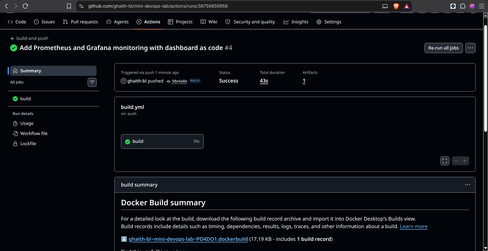
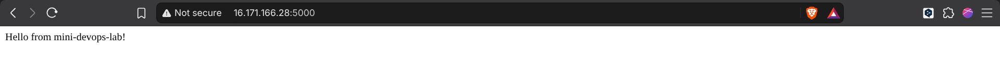
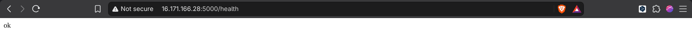
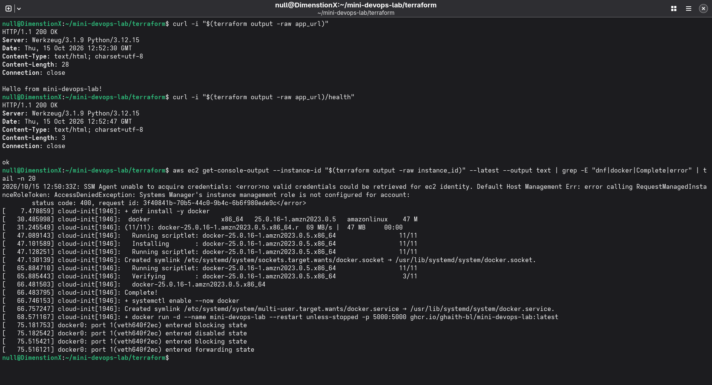
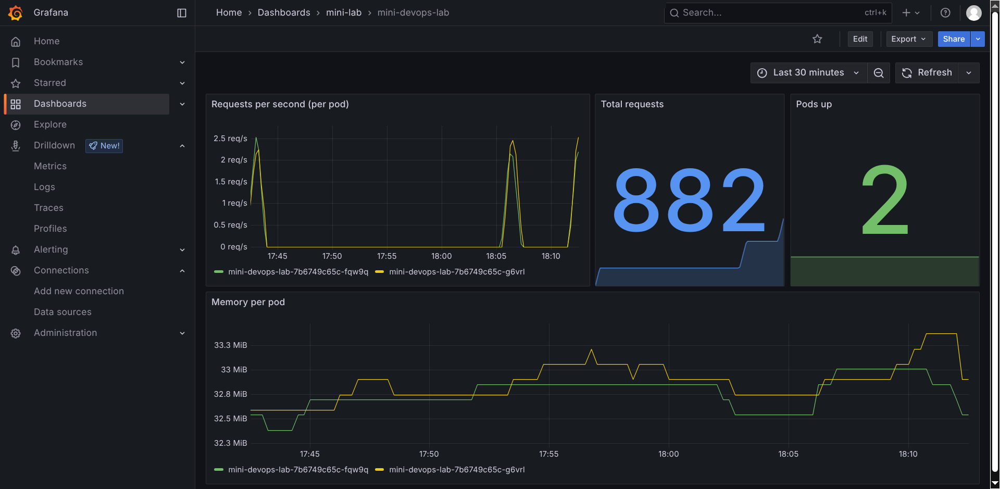

# mini-devops-lab

My first hands-on DevOps lab.

The goal was not to build something big. The goal was to understand
**how the pieces connect**: from a small app, to a container, to Kubernetes,
to CI, to the cloud with Terraform, and finally to monitoring.

I built it in small steps. I ran every command myself and checked the output
before moving to the next step.

## How it fits together

```
                    app/  (Flask + Dockerfile)
                     │                    │
        podman build │                    │ git push
                     ▼                    ▼
          local image (v2)          GitHub Actions
                     │ kind load          │ build + push
                     ▼                    ▼
     kind cluster (my laptop)       GHCR: ghcr.io/ghaith-bl/mini-devops-lab
     ├─ mini-lab:   2 app pods            │ docker run (first boot)
     └─ monitoring: Prometheus → Grafana  ▼
                                    AWS EC2 t3.micro (created by Terraform)
```

## Tools

Python (Flask) · Podman · kind · kubectl · GitHub Actions · GHCR ·
Terraform · AWS EC2 · Prometheus · Grafana

My machine: Fedora Silverblue, SELinux enforcing, rootless Podman (no Docker).

## The 6 phases

### 1. The app — [`app/`](app/)

A very small Flask app on port 5000 with three routes:

| Route | What it returns |
|-------|-----------------|
| `/` | A hello message (counts each visit) |
| `/health` | `ok`, used by Kubernetes probes |
| `/metrics` | Metrics for Prometheus, incl. the counter `app_requests_total` |

### 2. The container — [`app/Dockerfile`](app/Dockerfile)

- Based on `python:3.12-slim`.
- Dependencies are copied first, so rebuilds are faster (layer caching).
- Runs as a **non-root** user.
- The app handles `SIGTERM`, so it stops cleanly when Podman or Kubernetes stop it.

### 3. Kubernetes with kind — [`k8s/`](k8s/)

- Namespace `mini-lab`.
- Deployment with **2 replicas**, readiness + liveness probes on `/health`,
  and small CPU/memory limits.
- Service (ClusterIP) that sends port 80 to port 5000 on the pods.

### 4. CI with GitHub Actions — [`.github/workflows/build.yml`](.github/workflows/build.yml)

On every push to `main`, GitHub Actions builds the image and pushes it to
GitHub Container Registry with two tags: `latest` and `sha-<commit>`.



### 5. Terraform + AWS — [`terraform/`](terraform/)

Terraform creates one `t3.micro` EC2 instance in `eu-north-1`:

- The security group opens port 5000 **to my IP only**. There is no SSH.
- On first boot, a user data script installs Docker and runs the image from GHCR.
- I debug the server with `aws ec2 get-console-output`, not SSH.
- After each test I run `terraform destroy`, so nothing keeps costing money.

Details: [`terraform/README.md`](terraform/README.md)

The app answering from the EC2 server:




Boot log: Docker is installed and the container starts:



> The server in these screenshots does not exist anymore. It was destroyed after the test.

### 6. Monitoring — [`k8s/monitoring/`](k8s/monitoring/)

- **Prometheus** finds the app pods with Kubernetes service discovery
  and reads `/metrics` every 15 seconds.
  It only has read-only access to pods in `mini-lab`.
- **Grafana** gets its datasource and dashboard from files
  (dashboard as code), so they come back after the pod restarts.
- The admin password is a Kubernetes Secret created from a hidden prompt.
  It is never stored in git.

Dashboard: requests per second per pod, total requests, pods up, memory per pod.



Details: [`k8s/monitoring/README.md`](k8s/monitoring/README.md)

## How to run it

### Run the app locally with Podman

```bash
podman build -t localhost/mini-devops-lab:v2 app/
podman run --rm -d --name mini-devops-lab -p 5000:5000 localhost/mini-devops-lab:v2
curl http://127.0.0.1:5000/health
podman stop mini-devops-lab
```

### Run it in kind

Needs a kind cluster running with the Podman provider.

```bash
# Load the local image into kind (the Deployment never pulls it from a registry)
podman save localhost/mini-devops-lab:v2 -o mini-devops-lab.tar
kind load image-archive mini-devops-lab.tar
rm mini-devops-lab.tar

kubectl apply -f k8s/namespace.yaml
kubectl apply -f k8s/deployment.yaml
kubectl apply -f k8s/service.yaml
kubectl get pods -n mini-lab
```

### Deploy to AWS

See [`terraform/README.md`](terraform/README.md).

### Add monitoring

See [`k8s/monitoring/README.md`](k8s/monitoring/README.md).

## Choices I made on purpose

- **Keep it basic.** One small app, one server, no extra features.
  Scaling comes later.
- **Low cost.** No EKS, no NAT Gateway, no Load Balancer.
  Kubernetes runs locally in kind, and AWS is destroyed after every session.
- **Security basics.** Non-root container, app port open to my IP only,
  no SSH, no secrets in git.

## How I built it

I used Claude (an AI assistant by Anthropic) as a guide during this lab.
It explained each step before we did it. I ran every command on my own
machine, read the output, and tested each phase before moving on.
